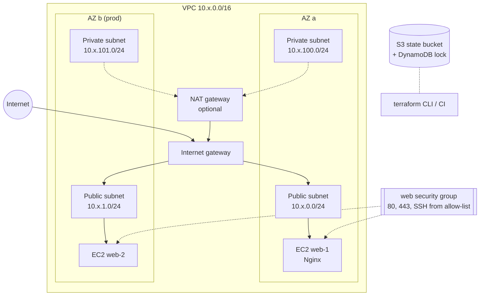

# Terraform Infrastructure (AWS)


Reusable Terraform modules that build a small but realistic AWS environment:
- a multi-AZ VPC with public and private subnets, an internet gateway and an optional NAT gateway
- a security group with SSH limited to allowed CIDRs
- encrypted, IMDSv2-only EC2 web servers

**dev** and **prod** use the same modules with different variables. State lives in a versioned, encrypted S3 bucket, with a DynamoDB table for locking.

> Portfolio project. Every push runs `fmt`, `validate` and `tflint` in CI. Running `plan` or `apply` needs your own AWS account and may cost money. Keep `enable_nat_gateway = false` and `t3.micro` to stay in the free tier.

## Architecture



## Layout

```
modules/
  vpc/        # VPC, subnets per AZ (cidrsubnet), IGW, route tables, optional NAT
  security/   # web security group, SSH allow-list via for_each
  compute/    # EC2 instances: latest Ubuntu AMI via SSM, gp3 encrypted root, IMDSv2, user_data
environments/
  dev/        # 1 AZ, 1 x t3.micro, no NAT
  prod/       # 2 AZs, 2 x t3.small, NAT on
bootstrap/    # S3 + DynamoDB remote state backend (run once)
```

## Terraform practices covered

- **Reusable modules** with documented `variables.tf` / `outputs.tf`
- **Input validation:** CIDR format and AZ count range
- **Dynamic resources:** `count`, `for_each`, splat outputs and `cidrsubnet()` subnet maths
- **Remote state:** versioned, encrypted S3 bucket with public access blocked, DynamoDB state locking, and `prevent_destroy` on the bucket
- **Per-environment config** through `terraform.tfvars` and a partial backend config (`backend.hcl`)
- **Default tags** on every resource through the provider
- **CI:** `terraform fmt -check`, `validate` across all roots, and `tflint` with the AWS ruleset

## Usage

```bash
# 1. One-time: create the state backend
cd bootstrap
terraform init && terraform apply -var state_bucket_name=<unique-bucket-name>

# 2. Configure an environment
cd ../environments/dev
cp backend.hcl.example backend.hcl   # set the bucket name
terraform init -backend-config=backend.hcl
terraform plan -out=tfplan
terraform apply tfplan
terraform output web_urls

# 3. Clean up
terraform destroy
```

Or use the Makefile: `make validate ENV=prod`, `make plan ENV=dev`.

## Tech stack

Terraform · AWS (VPC, EC2, S3, DynamoDB, SSM) · tflint · GitHub Actions

## License

MIT
